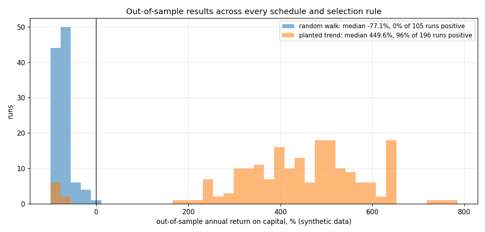
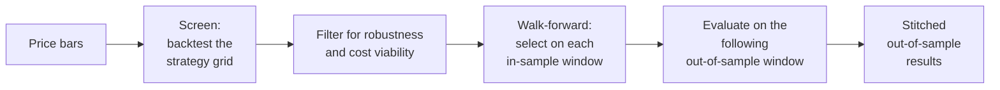

# wfo-gpu

[](https://github.com/triwebb1/wfo-gpu/actions/workflows/ci.yml)
[](LICENSE)
[](https://en.cppreference.com/w/cpp/20)

**GPU-accelerated walk-forward optimization for evaluating systematic trading strategies.**

wfo-gpu measures whether a family of trading strategies retains its performance when it is periodically re-optimized and then traded on data it has not seen. It backtests hundreds of thousands of strategy configurations on an OpenCL device or a multithreaded C++ engine with matching results, filters them for robustness and cost viability, and evaluates the survivors with walk-forward re-optimization across 434 schedule and selection-rule combinations.



<sub>Out-of-sample results of every walk-forward run on two synthetic datasets. None of the runs on a random walk (blue) is profitable; on a series with a planted trend (orange), the edge is identified and persists out of sample. Produced by the quick start below; details in [Example results](#example-results).</sub>

| | |
|---|---|
| **Scope** | Two-stage research pipeline: a parameter screen over a combinatorial strategy grid, followed by walk-forward re-optimization with out-of-sample evaluation |
| **Validity controls** | Lookahead prevented by construction and checked by perturbation tests; spread and slippage charged on every trade; null-hypothesis runs on synthetic data |
| **Implementation** | C++20 and CMake; an OpenCL backtest kernel and a native C++ engine held to the same results; about 500 GoogleTest tests; CI on Linux and Windows |
| **Platforms** | Any OpenCL GPU or CPU device, or none; Windows and Linux are tested in CI, and the code compiles for macOS |

> **Project status.** This is a personal research project. It has a substantial test suite but has not undergone independent review or production hardening. Its output should be treated as research, not as trading advice.

## Contents

- [How it works](#how-it-works)
- [Quick start](#quick-start)
- [Example results](#example-results)
- [Engineering highlights](#engineering-highlights)
- [Using your own data](#using-your-own-data)
- [Documentation](#documentation)
- [Limitations](#limitations)
- [A note on results](#a-note-on-results)
- [Development approach](#development-approach)

## How it works

A strategy optimized and evaluated on the same history overstates its performance: given enough candidate configurations, some will fit the past by chance. Walk-forward analysis separates the two. Parameters are selected on an in-sample window and evaluated on the out-of-sample window that follows, and the process repeats across the data, so every reported result comes from bars the selection did not use.



1. **Screen.** Each strategy configuration is backtested over an initial range of the data. A configuration combines up to four of 643 signals (technical indicators and session-structure features) with weights, an aggregation rule, an entry threshold, one of 24 exit rules and a trading-hours filter. To advance, a configuration must clear sanity floors, earn an average net trade of at least twice its round-trip cost, and retain its consistency when any single parameter moves one grid step. The Pareto frontier of the survivors and its robust neighbors form the reduced set.
2. **Walk-forward.** The reduced set is evaluated under 62 schedules, each defined by a re-optimization interval, an in-sample lookback and an optional drawdown or losing-streak trigger. In each in-sample window, seven selection rules each choose one configuration, which then trades the following out-of-sample window at an entry delay of one bar and, as a robustness check, two bars. The out-of-sample segments are stitched into one result per schedule and selection rule.

## Quick start

Requirements: CMake 3.20 or later and a C++20 compiler (GCC 11+, Clang 14+ or MSVC 2022). An OpenCL SDK is optional; without one, all computation runs on the native C++ path. Third-party dependencies are fetched by CMake.

```sh
git clone https://github.com/triwebb1/wfo-gpu.git
cd wfo-gpu
cmake -B build -DCMAKE_BUILD_TYPE=Release
cmake --build build --config Release --parallel
ctest --test-dir build --build-config Release
```

The following runs the full pipeline on one year of synthetic 30-second bars, first a random walk and then a series with hidden trend regimes:

```sh
./build/wfo-gpu generate --out data/random_walk.bin --days 260
./build/wfo-gpu run --config config/example.toml --bars data/random_walk.bin

./build/wfo-gpu generate --out data/trending.bin --days 260 --trend 0.03
./build/wfo-gpu run --config config/example.toml --bars data/trending.bin --output output/trending
```

Each run screens 308,640 configurations and evaluates 434 walk-forward combinations, which takes about seven minutes on eight CPU threads. With the Visual Studio generator on Windows, the executables are in `build\Release\`.

## Example results

Results of the two quick-start runs with `config/example.toml`. The screen uses approximately the first 22 sessions; walk-forward evaluation trades only the bars after them. All figures come from synthetic data.

| | Random walk (no edge) | Planted trend (known edge) |
|---|---:|---:|
| Configurations screened | 308,640 | 308,640 |
| Passed the sanity floors | 18,828 | 23,504 |
| Retained for walk-forward | 19 | 57 |
| Walk-forward runs with at least 4 windows | 105 | 196 |
| Median out-of-sample annual return on capital | -77.1% | +449.6% |
| Profitable out-of-sample runs | **0 of 105** | **188 of 196** |

On the random walk, thousands of configurations pass the screen by chance, and none of the resulting walk-forward runs is profitable out of sample. On the trending series, the pipeline identifies the planted edge and nearly all runs remain profitable. A sound optimizer must exhibit both behaviors; the [methodology](docs/METHODOLOGY.md#9-null-hypothesis-check) describes the check.

<details>
<summary>Command-line output of both runs (abridged)</summary>

Random walk:

```text
Screen
  strategies evaluated   308640
  passed sanity floors   18828
  economically viable    3865
  on Pareto frontier     7
  kept for walk-forward  19

Out-of-sample across 105 runs with 4+ windows: median ROC -77.09%, 0 of 105 profitable

Top runs by out-of-sample return on capital
step   lookback trigger   selection            OOS ROC%  Sharpe     PF    MaxDD$  trades windows
30d    30d      fixed     best_roc                -7.12   -0.12   0.98     58398    1060      11
30d    30d      fixed     best_consistency       -30.30   -0.55   0.93     77409    1005      11
14d    30d      fixed     frontier_centroid      -32.97   -0.56   0.93     60848    1132      23
```

Planted trend:

```text
Screen
  strategies evaluated   308640
  passed sanity floors   23504
  economically viable    10295
  on Pareto frontier     17
  kept for walk-forward  57

Out-of-sample across 196 runs with 4+ windows: median ROC 449.56%, 188 of 196 profitable

Top runs by out-of-sample return on capital
step   lookback trigger   selection            OOS ROC%  Sharpe     PF    MaxDD$  trades windows
14d    183d     fixed     best_roc               784.78    4.25   1.50     33993     907      12
14d    183d     fixed     roc_x_consistency      744.73    4.19   1.49     33993     926      12
14d    91d      fixed     roc_x_consistency      723.33    5.45   1.65     27268    1476      19
```

The command-line report presents the distribution before the top-ranked runs. The top-ranked runs are selected after the fact from many correlated results and therefore overstate expected performance.

</details>

## Engineering highlights

- **Implicit strategy grid.** The grid spans more than 4 x 10^15 configurations and is never materialized. Any configuration is reconstructed from its index by combinatorial unranking, neighbors are located by index arithmetic, and configurations that would trade identically are skipped.
- **GPU batch evaluation.** One work-item per configuration over Structure-of-Arrays bar buffers, a single kernel launch per batch with work-items ordered by signal set and exit rule, pooled device buffers, and kernel sources embedded in the binary at build time.
- **Device-independent results.** Signals are computed on the host, the kernel is compiled without floating-point contraction, and every result that informs a decision is recomputed by the C++ engine. End-to-end tests require the screen and the walk-forward stage to produce the same results on an OpenCL device as on the native path.
- **Lookahead controls.** Fills occur strictly after the signal bar, higher-timeframe indicators read only completed bars, session features are withheld until their inputs exist, and in markets with a daily close, positions are closed at each session close. Regression tests perturb all bars after a cut point and require every signal up to that point to remain bit-identical.
- **Robust selection.** Sanity floors, a cost-based viability floor, a parameter-neighborhood stability score, a five-objective Pareto frontier and seven interchangeable selection rules.
- **Fault-tolerant long runs.** Atomic, durable file replacement on Windows and POSIX; CRC32C-verified checkpoints bound to the configuration and the input data; stages that resume from their last checkpoint, with tests that interrupt a run twice and compare the result with an uninterrupted run; and a single-instance run lock.
- **Independent verification.** Kernel results are compared with the C++ engine, indicator values with a separate NumPy implementation, and the command-line pipeline is exercised end to end in CI.

Measured throughput, together with the benchmark workload and the command that reproduces it, is reported in [docs/BENCHMARKS.md](docs/BENCHMARKS.md).

## Using your own data

Bars are imported from CSV files with `timestamp,open,high,low,close,volume` columns. The configurations in `config/` cover E-mini equity index futures (`es.toml`), gold futures (`gc.toml`) and a 24-hour cryptocurrency market (`btc.toml`).

```sh
./build/wfo-gpu convert --csv my_bars.csv --out data/my_bars.bin --symbol ES
./build/wfo-gpu info --bars data/my_bars.bin
./build/wfo-gpu run --config config/es.toml --bars data/my_bars.bin
```

A run writes the following to its `[data] output` directory:

| File | Contents |
|---|---|
| `summary.csv` | one row per schedule and selection rule: out-of-sample PnL, return on capital, Sharpe ratio, drawdown |
| `equity/*.csv` | stitched out-of-sample equity curves (plotted by `tools/plot_equity.py`) |
| `details/*.csv` | per-window results: in-sample and out-of-sample metrics, the two-bar-delay re-test, the selected configuration |
| `landscape_summary.csv` | the screen's filtering funnel and the distributions of surviving configurations |
| `reduced_params.bin`, `all_results.bin` | the configurations passed to walk-forward, and every screen result |
| `meta_analysis.csv` | average out-of-sample performance by selection rule (descriptive, since it is computed on out-of-sample data) |
| `checkpoints/` | state for resuming with `--resume` |

Additional commands:

- `wfo-gpu info --strategy ID` describes the rules of any configuration listed in the reports; `info --signals` lists the signal catalog.
- `wfo-gpu detail --config config/es.toml --bars data/my_bars.bin --ids ids.txt` writes complete trade logs and quarterly PnL for selected configurations.
- `tools/plot_distribution.py` produces the distribution chart shown above for any set of runs.

The backtest engines accept plain arrays, so any series in [-1, +1] aligned to the bars can serve as a signal. [`examples/custom_signal`](examples/custom_signal/main.cpp) evaluates exit rules over a user-defined indicator, and [`examples/walk_forward_loop`](examples/walk_forward_loop/main.cpp) implements a walk-forward loop directly on the library interfaces.

## Documentation

| Document | Contents |
|---|---|
| [ARCHITECTURE.md](docs/ARCHITECTURE.md) | data layer, signals, strategy grid, GPU and CPU backends, selection, reliability and testing |
| [METHODOLOGY.md](docs/METHODOLOGY.md) | the backtesting rules the engine enforces, their rationale, and known limitations |
| [DATA_FORMAT.md](docs/DATA_FORMAT.md) | the binary bar format, CSV import, and reading the format from Python |
| [BENCHMARKS.md](docs/BENCHMARKS.md) | measured throughput and reproduction instructions |

## Limitations

- Bar data only: no order book, queue position or partial fills.
- One contract per position, with constant spread and slippage.
- Built-in session models cover US futures trading hours and 24-hour markets.
- The screen enumerates the strategy grid in order: all single-signal configurations first, then pairs as far as the configured budget allows.
- The software is a research tool and does not place orders.

The complete list is in the [methodology](docs/METHODOLOGY.md#10-known-limitations).

## A note on results

I have run a great many strategies through this pipeline, and none of them held up out of sample over multi-year periods. That is a statement about what I tested and how this tool tests it (systematic signals on bar data, with realistic costs), not about markets in general.

If you find one that holds up, please let me know. I'll wait.

## Development approach

I developed wfo-gpu using spec-driven development. Before implementation, I wrote the specification and the backtesting standards: the two-stage screen and walk-forward design, the lookahead and cost rules (now [docs/METHODOLOGY.md](docs/METHODOLOGY.md)), the robustness and selection criteria, the fault-tolerance requirements, and the parity contract between the GPU and CPU engines. I then directed the implementation against that specification with an AI coding agent (Claude), made and reviewed the design decisions, and defined the verification strategy: GPU/CPU parity tests, an independent NumPy cross-check, lookahead perturbation tests and null-hypothesis runs on synthetic data.

That verification identified a real defect during development. A random-walk run that appeared profitable out of sample led to [the full-pipeline lookahead test](tests/test_lookahead.cpp), which traced the cause to session-feature gates that compared clock times across the overnight session boundary.

## License

[MIT](LICENSE)
