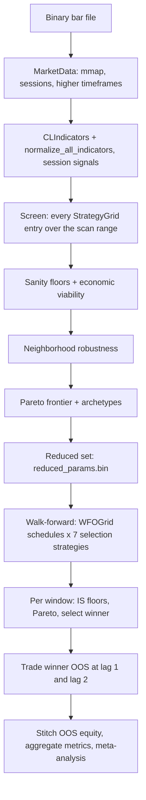

# Architecture

wfo-gpu is a C++20 engine for testing whether a family of trading strategies survives walk-forward re-optimization. Strategies are scored on a GPU through OpenCL, or on a multithreaded native C++ path that produces the same backtest results. This document describes how the pieces fit together. All names refer to code under `src/`.

## 1. Overview

A run has two stages. The `Orchestrator` (`orchestrator.h`) owns both.



**Screen** (`Orchestrator::run_screen`). The screen sweeps the full strategy grid over a scan range of the bar file. A strategy is a combination of up to four signals, a weight per signal, an aggregation mode, an entry threshold, an exit mode, a signal-role pattern and a trading-hours filter (section 4). Each result is checked against `SanityFloors` and an economic-viability floor: `BacktestResult::viable` requires the average net trade to be at least twice `CostModel::round_trip_cost()`. Survivors are scored for parameter-neighborhood robustness (`robustness.h`). A five-objective Pareto frontier is extracted from viable survivors (`pareto.h`). Frontier members are classified as Grinder, Sniper or Balanced. The frontier plus robust neighbors becomes the reduced set (`landscape.h`).

**Walk-forward** (`Orchestrator::run_walk_forward`, `WFOEngine` in `wfo_engine.h`). The reduced set is re-optimized under every schedule in `WFOGrid` (`grids/wfo_grid.h`): a re-optimization frequency, an in-sample lookback, and either a fixed interval or an adaptive trigger. Windows roll forward with a fixed-length lookback. For each in-sample (IS) window, the engine evaluates the reduced set, applies IS floors, extracts a Pareto frontier and picks one winner with each of seven selection strategies (`selection.h`). The winner trades the following out-of-sample (OOS) segment at entry lag 1, is re-tested at entry lag 2, and the OOS segments are stitched into one equity curve per (schedule, selection strategy) pair.

The stages share the same data layer, signal layer, strategy representation and compute backends.

## 2. Data layer

### Bar files

Bars live in a binary file: a 64-byte `FileHeader` (magic `WFBT`, version, bar count, symbol, timeframe, time range) followed by packed 32-byte `Bar` records (UTC nanosecond timestamp, OHLC as `float`, `uint32_t` volume). The layout is pinned with `static_assert`s. See [DATA_FORMAT.md](DATA_FORMAT.md) for the byte-level specification. `bar_io.h` writes the format and imports CSV; `synthetic.h` generates bars.

`MarketData::load` memory-maps the file (file mapping on Windows, `mmap` on POSIX), so bar access is zero-copy. After `load` returns, a `MarketData` is immutable and safe to read from many threads. `data_hash()` is an FNV-1a 64-bit hash over the mapped header and bars, stamped into checkpoints. `bars_per_calendar_day()` converts day-based window lengths into bar counts.

### Session model

`SessionModel` (`session_model.h`) describes how a market's trading day is laid out. Two models are built in:

| Model | Clock | Session day | Daily close | Core hours | Halts | Session signals |
|---|---|---|---|---|---|---|
| `us_futures` | US Eastern with DST | 18:00 to 17:00, one-hour break | flat at 17:00 | 09:30-16:00, split 12:00 | detected | on |
| `continuous` | UTC | UTC calendar day | none | 13:30-20:00, split 16:30 | off | off |

Every field can be overridden from the `[session]` config section.

While loading, `MarketData` builds one `SessionInfo` per bar: session day index, index within the session, local time of day, halt and early-close markers, the session's close time and the gap to the previous bar. It also stamps `SessionInfo::flags` with `SessionFlag` bits:

| Bit | Meaning |
|---|---|
| `SESSION_IN_CORE` | inside core hours |
| `SESSION_IN_MORNING` | core open to core split |
| `SESSION_IN_AFTERNOON` | core split to core close |
| `SESSION_CLOSE_BAR` | last bar before the daily close: the bar in the final slot, or, when that slot is missing, the bar after which the session ends or the close passes |
| `SESSION_HALTED` | at or after an abnormal core-hours gap in this session |
| `SESSION_AFTER_CLOSE` | between the daily close and the next open (after an early close, or stray data); never takes entries |

The backtest engines read only these flags, so the same CPU and GPU code serves any market the model can describe. `stamp_session_flags` recomputes the flags for hand-built session arrays.

**Early closes.** The model names an early-close calendar (`config/cme_early_closes.csv` for `us_futures`, rows of `YYYY-MM-DD,HH:MM` keyed by the session's close date), looked up next to the bar file and in `config/`. On a listed date the session's `session_close_sec` moves earlier, which moves `SESSION_CLOSE_BAR` and the flat-at-close exit with it, and bars after the early close get `SESSION_AFTER_CLOSE`. The bundled calendar is an approximation of the CME equity-index schedule; check it against the exchange's published hours before relying on it.

**Calendar keys.** A session is named by the local date it closes on, so Sunday evening starts Monday's session. Weekly, monthly and yearly metrics bucket sessions by that date.

**Halts.** When two consecutive core-hours bars in one session are more than `halt_gap_sec` apart, the bars from that gap to the end of the session get `halt_flag`. Earlier bars of the session are untouched, so the flag never reveals a halt before it happens. The backtest engines take no new entries on halted bars, and session signals that declare `suppress_on_halt()` read as neutral.

### Higher timeframes

`MarketData` pre-aggregates the base bars into 1m, 2m, 5m, 15m, 30m and 1h bars (`TimeframeData`). Boundaries are taken on the session clock and a higher-timeframe bar never spans two sessions. Each timeframe carries two maps from base bar to higher-timeframe bar:

- `parent_map[i]` is the bar that *contains* base bar `i`. That bar is still forming while bar `i` is open, so its OHLC includes later base bars.
- `completed_map[i]` is the latest bar that is *complete* at the close of base bar `i`, or `-1`. Completion is determined by the clock (`bar end >= boundary + timeframe`), not by the arrival of the next bar, so the map stays causal across missing bars.

Anything a strategy acts on at bar `i` must use `completed_map`. Anchored indicators are broadcast through it (section 3), which is what keeps them free of lookahead.

## 3. Signals

### Technical indicators

`indicators/indicator.h` defines the `Indicator` interface: `compute(bars, start, end, output)` writes one or more series, plus `num_series()`, `warmup_bars()` and `name()`. Sixteen types are implemented (EMA/SMA cross, RSI, ATR, MACD, ADX, Bollinger, Keltner, Stochastic, CCI, ROC, VWAP, OBV, Donchian, pivot points, HMA, Connors RSI). `IndicatorGrid` (`grids/indicator_grid.h`) enumerates every parameter combination with a contiguous integer ID and supports reverse lookup. Each grid entry expands into one `IndicatorSpec` per output series.

`CLIndicators` (`compute/cl_indicators.h`) computes specs with the C++ indicator classes on the host by default, so every device sees bit-identical signals and the device cannot change which strategies trade. Indicator work is small next to the backtests. With `[compute] indicators_on_device = true`, specs that have a kernel in `kernels/indicators.cl` (EMA, SMA, RSI, ATR, MACD, Bollinger, Keltner, CCI, ROC, OBV, HMA) run on the device instead, batched with one work-item per parameter set; that is faster on very large files, at the cost of floating-point differences between devices. Every consumer extends its load range backward by the maximum warmup (`max_indicator_warmup`, `compute/indicator_warmup.h`) so indicators converge before the evaluation range starts.

**Window modes.** `WindowMode` (`grids/window_mode_grid.h`) selects between two computations of the same indicator:

- `ROLLING`: computed directly on base bars; the window slides every bar.
- `ANCHORED_1M` to `ANCHORED_1H`: computed on the pre-aggregated timeframe, then broadcast back to base bars by `compute_anchored` through `completed_map`. The value only changes when a higher-timeframe bar completes.

`CLIndicators::compute_with_bars_anchored` dispatches specs of either mode, and `WindowModeGrid` enumerates sensible (indicator, mode) pairs, pruning combinations whose effective lookback exceeds a week. The built-in screen and walk-forward pipelines compute technical indicators in `ROLLING` mode.

### Normalization

`normalize_to_signal` (`indicators/signal_normalize.h`) turns the raw series of one indicator into a single per-bar signal in [-1, +1], where +1 is maximum bullish, -1 maximum bearish and 0 neutral. NaN passes through for warmup bars. The mapping depends on the indicator family: oscillators scale linearly beyond their overbought and oversold levels, channels use band position (mean-reversion or breakout), crosses use the sign of fast minus slow, ADX emits direction only above its trend threshold, ROC scales with the square root of its period, OBV and HMA use slope, and ATR is non-directional (always 0). `normalize_all_indicators` applies this to the whole grid, producing exactly one signal per `IndicatorGrid` entry. Every downstream component assumes this range.

### Session signals (futures only)

`session_signals/` holds eight modules derived from session structure: opening range, intraday structure, multi-day patterns, level interaction, volatility regime, gap analysis, overnight context and calendar. Each `SessionSignal` computes values per session day, already in [-1, +1], and declares for each output the local time after which it is valid (`signal_available_after_et_seconds()`). For example, an opening-range direction is not valid until the range has closed. `SessionSignalGrid` enumerates their parameter combinations.

`broadcast_session_signal_to_bars` expands day values to bars and applies the gates. A bar sees its own session's value once the session has reached the availability time, compared as time elapsed since the open. Before that it reads 0, except for outputs available only from the core close (16:00): those describe a whole regular session, so a bar sees the previous session's value until the current one exists. An early-close day suppresses outputs available after its close, `suppress_on_halt` modules read 0 when their source session was halted, and NaN reads 0. `append_session_signal_series` (`grids/session_signal_grid.h`) computes and broadcasts the whole grid; the screen, walk-forward and `detail` all use it. `BacktestEngine::run` also has an overload that takes `SignalTimeGate` per series for callers that broadcast their own arrays.

Session signals are computed only when `SessionModel::session_signals` is set and a `MarketData` is available. The module is built on the 09:30-16:00 ET equity session, so a config that sets other core hours turns it off. Session signals are appended after the technical signals, so a strategy's signal indices cover both.

## 4. Strategy representation

`StrategyConfig` (`backtest_engine.h`) is what the engines execute:

- up to four signal indices, each with a weight and a role (`SIGNAL` contributes direction; `FILTER` must be non-zero for any entry);
- an aggregation mode: `WEIGHTED_SUM` (weighted mean of non-NaN signals), `MAJORITY_VOTE` (sign of the long-minus-short vote count), `UNANIMOUS` (all non-zero signals agree);
- an entry threshold: composite above `+threshold` goes long, below `-threshold` goes short;
- an exit mode: signal reversal, bar timeout, ATR trailing stop, opposing signal, ATR max-loss, ATR take-profit, or combined ATR take-profit and stop-loss. ATR-based exits use the engine's own Wilder `ATR(EXIT_ATR_PERIOD)`, computed from completed bars of the evaluated range, unless `atr_series_index` names a caller-supplied series, which is read at the previous bar;
- a trading-hours filter: `ETH`, `RTH`, `MORNING` or `AFTERNOON`, tested against `SESSION_IN_CORE`, `SESSION_IN_MORNING` and `SESSION_IN_AFTERNOON`.

Every strategy follows the same execution rules. A signal on bar N fills at the open of bar N + `entry_lag`, never on the same bar. Only one position is open at a time. Signal-driven exits fill at the next open. Level exits never fire on the entry bar; stops fill at the level or at the open if the bar gaps through it, targets fill at the level, and the stop wins when both trigger on the same bar. The trailing stop and the exit ATR only use bars before the one being tested. When the model is flat at close, any position open on the `SESSION_CLOSE_BAR` bar exits at that bar's close (a market-on-close order); a signal exit raised on that bar becomes this fill too, and only a stop or target that already filled intrabar takes precedence. No entry fills on a `SESSION_AFTER_CLOSE` bar. Positions still open at the end of the range are force-closed at its last bar, or at the checkpoint bar of an early-terminated run. Each trade deducts the round-trip cost (spread plus slippage on both sides) and records its worst and best unrealized PnL. `Trade::fill_type` records how each trade closed.

### The grid is never materialized

`StrategyGrid` (`grids/strategy_grid.h`) enumerates compositions over N signals: every subset of 1 to 4 signals (combinatorial number system), times 4^k weight combinations, times 3 aggregations, 4 thresholds, 24 exit presets (`ExitModePreset`), 4 trading-hours options and 2 role patterns. `total_count()` is computed analytically and `entry_at(index)` reconstructs any entry from its flat index by combinatorial unranking. Ids are ordered by subset size (every 1-signal entry, then every 2-signal entry, ...). The screen walks the index space in order, in batches, and never holds more than one batch of configs, so its strategy budget decides how far it reaches: the example config's 308,640 distinct strategies are exactly the single-signal block. Result ids are 32-bit, which caps a screen at the first 2^31 grid entries. Entries that trade identically to another entry (`is_redundant()`: vote modes ignore weights and thresholds, filters ignore their weight, weighted sums ignore the scale of their weights) are skipped, and `max_strategies` counts only the distinct strategies evaluated.

The inner layout of the flat index is constant (role, hours, exit, threshold, aggregation, weight rank, innermost first), and `axis_descriptors(k)` exposes each axis's stride and range. `StrategyGrid::neighbors(index)` uses them to find a strategy's one-step neighbors by index arithmetic alone, with positions taken inside the strategy's k-indicator block so a step never leaves its indicator subset. A `static_assert` pins the per-weight block size so a layout change cannot silently break neighbor geometry.

## 5. Compute backends

Two classes dispatch work: `CLIndicators` for indicators and `CLBacktest` (`compute/cl_backtest.h`) for backtests. Both take a `CLContext` and fall back to the native C++ path when it is unavailable.

### Device selection

`CLContext::initialize(DeviceType)` accepts:

| `DeviceType` | Config / CLI name | Behavior |
|---|---|---|
| `AUTO` | `auto` | first OpenCL GPU, else an OpenCL CPU device, else native |
| `GPU` | `gpu` | OpenCL GPU only |
| `CPU` | `opencl-cpu` | OpenCL CPU device (runs the kernels without a GPU) |
| `NATIVE` | `native` | skip OpenCL; multithreaded C++ |

The process-wide default is set from `[compute] device` or `--device`. Each stage logs which device it selected. OpenCL is optional at build time: without an SDK, `HAS_OPENCL` is undefined and only the native path is compiled.

### Kernels embedded at build time

`kernels/indicators.cl` and `kernels/backtest.cl` are converted by `cmake/EmbedKernel.cmake` into generated headers holding a byte array and its length (`wfo::BACKTEST_CL_SOURCE`, `wfo::INDICATORS_CL_SOURCE`). Programs are built from these arrays at runtime, so the GPU path never depends on the working directory or on files shipped beside the executable.

### Backtest kernel

`evaluate_backtest` runs one work-item per strategy. Inputs are Structure-of-Arrays bar buffers (open, high, low, close), a per-bar `SessionFlag` buffer, a flat indicator buffer (`series * num_bars + bar`) and one packed parameter struct per strategy. Each work-item writes raw accumulators (`BacktestResultGPU`): PnL, trade and win counts, gross wins and losses, drawdowns, time in position and unrealized extremes. The host converts these into a `BacktestResult` with the same formulas as `compute_metrics`, calendar time included (from the first and last evaluated bar's timestamps). The kernel is compiled with `FP_CONTRACT` off and, where the device supports it, correctly rounded division, so composite signals that land exactly on a threshold compare as they do on the CPU.

Host-side dispatch is shaped for the device:

- **One launch per batch.** Work-items are ordered by sorted signal set, then exit mode, so neighbours read the same indicator columns and take the same branches.
- **Pooled buffers.** `cl_mem` objects and host staging vectors persist across calls and are reallocated only when a larger size is needed. Their contents are rebuilt every call; callers recycle signal buffers, so pointer identity says nothing about contents.

Any OpenCL failure inside `evaluate_gpu` is logged and the batch is re-run on the native path.

### Native path

`CLBacktest::evaluate_cpu` runs `BacktestEngine` (a stateless evaluator; one instance per thread) across worker threads. The thread count comes from `ResourceMonitor::max_threads()`, so the CPU limit is enforced through parallelism. Small batches run on the calling thread.

### Parity

Both paths produce the same per-strategy accumulators, and the parity tests in `tests/test_opencl.cpp` and `tests/test_session_close.cpp` compare them across exit modes, entry lags, trading-hours filters, session closes, early closes, halts and grouped dispatch. Metrics that need per-trade timestamps (weekly, monthly and yearly consistency, Sharpe) are only computed by `compute_metrics` on the CPU, and `BacktestResult::metrics_complete` records whether a result carries them.

The pipeline is built so the device cannot change a decision:

- signals are computed on the host (unless `indicators_on_device` is set);
- the screen re-runs every viable or floor-passing GPU result on the CPU engine and takes the CPU result wholesale, so floors, robustness, the frontier and the reduced set read CPU results only; robustness and reduced-set neighbors must be viable, and every viable result is refined;
- walk-forward re-runs in-sample floor survivors on the CPU before selection, and every out-of-sample run (lag 1, lag 2 and the PnL decomposition) uses the CPU engine;
- `EarlyTermination` (an opt-in screen setting, `[screen] early_termination`) runs on the native path.

`tests/test_device_parity.cpp` runs the screen and the walk-forward end to end on an OpenCL device and on the native path and requires the same results, reduced set and runs.

### Device memory

A batch uploads four price arrays and one flag word per bar, the signal matrix (one float per signal per bar) and one parameter and result struct per strategy. If an allocation or any other OpenCL call fails, `evaluate_gpu` returns false, the failure is logged and the batch runs on the native path with the same results. Windows are never split: a backtest that restarted part-way through a window would close positions and restart its exit ATR at the split.

## 6. Selection and robustness

### Pareto frontier

`extract_pareto_frontier` keeps non-dominated results over five objectives, all oriented higher-is-better:

| Objective | Field |
|---|---|
| Return on capital | `annual_roc` (CAGR on `capital_required`) |
| Consistency | `green_weeks_pct` |
| Losing-streak resistance | `1 / (1 + max_red_weeks)` |
| Trade recovery | `trade_recovery_ratio` |
| Profit factor | `profit_factor` |

Return is measured on capital, not raw PnL, so instruments and contract sizes compare directly. Archetype thresholds come from the full survivor pool, not just the frontier: Grinders have high win rate and high green-week share, Snipers have low win rate and high return, everything else is Balanced.

### Selection strategies

`select_winner` picks one IS winner from the classified frontier:

| `SelectionStrategy` | Rule |
|---|---|
| `best_roc` | highest `annual_roc` |
| `best_consistency` | highest `green_weeks_pct` |
| `best_trr` | highest `trade_recovery_ratio` |
| `best_grinder` | highest `annual_roc` among Grinders |
| `best_sniper` | highest `annual_roc` among Snipers |
| `frontier_centroid` | closest to the frontier centroid in normalized objective space |
| `roc_x_consistency` | highest `annual_roc * green_weeks_pct` |

Archetype-specific strategies fall back to `frontier_centroid` when their archetype is empty. The walk-forward stage runs all seven on the same window evaluations and reports which one has the best average OOS return across schedules. That comparison is descriptive: it is made on out-of-sample results, so the winner's figure is optimistic.

### Robustness

For each strategy, `StrategyGrid::neighbors` gives the one-step neighbors on each of the six composition axes, and `Orchestrator::build_neighbor_functions` maps them to evaluated results. The grid size used is the signal count the screen enumerated (`Orchestrator::screen_signal_count` when reanalyzing a checkpoint). The score uses `green_weeks_pct`, which a single outlier trade cannot inflate:

```
retention(n)   = metric(n) / metric(s)
sensitivity(a) = 1 - min retention over the neighbors on axis a
robustness(s)  = 1 - max sensitivity over all axes
```

Only neighbors that were evaluated, are economically viable and carry complete metrics count. A per-strategy axis-coverage figure is reported alongside the score for diagnostics. Rough interpretation: at least 0.70 is a plateau, 0.50 to 0.70 a ridge, 0.30 to 0.50 a hill, below 0.30 a spike.

### Reduced set

`build_reduced_set` keeps every frontier member whose robustness meets `robustness_floor` (default 0.50), plus each such member's viable neighbors that also meet the floor. It works in positions of the results vector; the orchestrator maps them to strategy-grid ids, which are written to `reduced_params.bin` and are the only strategy input to walk-forward.

### Walk-forward details

- **Windows.** For lookback L and frequency F (both in bars), IS is `[t - L, t)` and OOS is `[t, t + F)`, starting at `t = max(L, oos_start_bar)` and stepping by F. The CLI sets `oos_start_bar` to the end of the screen range, so out-of-sample trading never reuses the bars the reduced set was chosen on. Schedules whose L + F exceeds the data are reported as insufficient.
- **Schedules.** `WFOGrid` crosses four frequencies (1 week to 1 quarter) with eight lookbacks (1 month to 5 years), dropping lookbacks shorter than the frequency, and adds adaptive schedules that step weekly but re-optimize only when a trigger fires: OOS drawdown of 5% or 10% of capital, or 5 or 10 consecutive losing trades. Between triggers the last deployed winner keeps trading; a window that deploys nothing re-optimizes on the next window. Trigger state is tracked per selection strategy.
- **IS floors.** At least 30 trades, profit factor above 1, positive return, and the 2x round-trip average-trade floor. A window with no survivors is skipped and contributes flat equity. A run with half or more of its windows skipped is marked insufficient.
- **Shared work.** The reduced set's indicators are computed once over the whole file; unused signal slots are NaN, which the aggregation modes skip. IS evaluations are shared by all seven selection strategies, and OOS signals are precomputed once per schedule.
- **Lag-2 re-test.** Every winner is re-run on its OOS segment with entry lag 2 on the CPU engine. If lag-2 Sharpe falls below half of a positive lag-1 Sharpe, `decompose_pnl` splits the lag-2 PnL into bar-body and gap components to show whether the edge depends on the fill assumption.
- **Stitching.** Lag-1 OOS trades are concatenated into one trade list for aggregate metrics and into a staircase equity curve for Sharpe and drawdown, bucketed by DST-correct session day. `parameter_stability` measures how much the chosen strategy changes across windows.

## 7. Reliability

**Checkpoints** (`checkpoint.h`). Screen and walk-forward progress are saved to `<output>/checkpoints/screen.wfck` and `walk_forward.wfck`. The header holds the magic `WFCK`, a format version, a grid-layout fingerprint (hash of the `StrategyGrid` axis constants), a config hash (FNV-1a over every input that changes the stage's results: scan range, costs, floors, entry lag, strategy budget and session model for the screen; costs, session model, out-of-sample start, bars per day and the reduced strategy set for walk-forward), the bar-data hash and the scan range. A trailing CRC32C covers every preceding byte. `Checkpoint::load` returns `std::nullopt` on any mismatch: bad magic, version outside the compatible band, different grid layout, config or data, truncation or CRC failure. Versions are not migrated.

**Durable writes** (`durable_file.h`). `DurableFileWriter::atomic_write` writes to a `.tmp` file beside the target while streaming a CRC32C, flushes it to stable storage (`FlushFileBuffers` on Windows; `fsync`, or `F_FULLFSYNC` where available, on POSIX), then replaces the target atomically (`MoveFileExW` with `MOVEFILE_WRITE_THROUGH`; `rename` followed by a directory `fsync`). A crash leaves the old file or the new one, never a mix, and an aborted writer deletes its `.tmp` file. Checkpoints and screen outputs use it. The walk-forward CSVs are ordinary writes whose stream state is checked; `--resume` on a finished run rewrites them from the final checkpoint.

**Run lock** (`run_lock.h`). Each stage holds an advisory lock in the checkpoint directory so two processes cannot resume into the same checkpoint. On Windows the lock is a `CREATE_NEW` file opened with `FILE_FLAG_DELETE_ON_CLOSE`; on POSIX it is `flock(LOCK_EX | LOCK_NB)`. Either way the OS releases it when the process dies. `--force-unlock` (Windows only) removes a leftover lock file; the removal fails while a live process holds it, so it cannot break an active lock. POSIX ignores it, since an `flock` cannot outlive its process.

**Resume semantics.** The screen writes a mid-run checkpoint every five minutes and a final one at the end. `--resume` on a completed screen checkpoint skips evaluation and re-derives the landscape from the stored results; on a partial one the screen continues after the last grid entry it holds. Walk-forward checkpoints after every schedule, with restored runs included, and the final checkpoint marks every schedule done: `--resume` continues from the next schedule, or only rewrites the outputs of a finished run. `tests/test_resume.cpp` interrupts runs, twice in a row for walk-forward, and requires the resumed result to match an uninterrupted one. A checkpoint that does not match the current config or bar file is an error unless `--fresh` discards it. `reanalyze` deliberately skips the config and data checks, because changing the floors is its purpose.

**Resource limits** (`resource_monitor.h`). `max_cpu_pct` caps worker threads at that share of logical processors. `max_ram_gb` is checked against process RSS at walk-forward schedule boundaries and a breach is logged. Defaults are all cores and 80% of physical memory; the `[resources]` section replaces them, and the environment variables `WFO_GPU_MAX_CPU_PCT` and `WFO_GPU_MAX_RAM_GB` take precedence over both.

## 8. Configuration and CLI

A run is described by a TOML file parsed into `RunConfig` (`config.h`). Unknown sections and keys are rejected, so a typo never falls back to a default silently.

| Section | Keys |
|---|---|
| `[data]` | `bars`, `output` |
| `[instrument]` | `symbol`, `tick_size`, `tick_value`, `point_value`, `spread_ticks`, `slippage_ticks`, `capital` |
| `[session]` | `model`, `session_open`, `session_close`, `flat_at_close`, `core_hours`, `halt_gap_minutes`, `early_close_calendar` |
| `[screen]` | `start`, `end` (bar index or UTC date), `max_strategies`, `robustness_floor`, `entry_lag`, `early_termination` |
| `[floors]` | `min_trades`, `min_profit_factor`, `min_annual_roc`, `min_total_pnl`, `max_negative_years` |
| `[compute]` | `device`, `indicators_on_device` |
| `[resources]` | `max_cpu_pct`, `max_ram_gb` |

Annotated examples live in `config/`.

The `wfo-gpu` executable (`src/cli/`) has these subcommands:

| Command | Purpose | Writes |
|---|---|---|
| `generate` | synthetic bar file | the bar file |
| `convert` | CSV to binary bar file | the bar file |
| `info` | show the system and OpenCL device; summarize a bar file; `--signals` lists signal IDs; `--strategy ID` decodes a strategy | nothing |
| `screen` | run the screen | `reduced_params.bin`, `landscape_summary.csv`, `all_results.bin` |
| `walk-forward` | run walk-forward on `reduced_params.bin` | `summary.csv`, `meta_analysis.csv`, `details/*.csv` (per-window), `equity/*.csv` (stitched OOS equity) |
| `run` | screen, then walk-forward | both of the above |
| `reanalyze` | re-apply floors to a finished screen checkpoint | screen outputs |
| `detail` | full trade logs for chosen strategy IDs, at lag 1 or 2; ids decode against the screen's grid, and ids outside it are rejected | `detail/detail_summary.csv`, `detail/trades/`, `detail/quarterly/` |

Optimization commands share `--config`, `--bars`, `--output`, `--device`, `--max-strategies`, `--resume`, `--fresh` and `--force-unlock`. Outputs go under `[data] output`, checkpoints and locks under its `checkpoints/` subdirectory.

## 9. Extending

The backtest engines consume plain arrays, not indicator objects. Any float series aligned to the bar array and kept in [-1, +1] (NaN while warming up) is a valid signal:

1. Compute your series over the bars you will evaluate, plus warmup.
2. Pass an array of `const float*` (one pointer per series) to `BacktestEngine::run`, or to `CLBacktest::evaluate` to use the GPU path.
3. Reference your series by index in `StrategyConfig::indicator_indices`, alongside or instead of the built-in signals.

To reuse the built-in plumbing, implement the `Indicator` interface. The same class then works in anchored mode through `compute_anchored`, and a normalization rule in `normalize_to_signal` maps its raw output into [-1, +1]. Session-structure signals implement `SessionSignal` and declare their availability times, and `broadcast_session_signal_to_bars` applies the gating. The `examples/` directory shows these patterns in runnable form.

## 10. Testing strategy

The suite (`tests/`, GoogleTest) runs on any machine. GPU tests skip themselves when no OpenCL device is present, unless `WFO_GPU_REQUIRE_OPENCL` is set (CI's OpenCL job), in which case a missing device fails them; an OpenCL CPU runtime executes the kernels without a GPU. Each test process works in its own scratch directory, so `ctest --parallel` is safe. `tools/pipeline_smoke.sh` drives the CLI end to end (run, resume, reanalyze, detail) and runs in CI.

| Layer | What it checks | Where |
|---|---|---|
| Unit | grids and unranking, indicators, normalization, metrics, cost model, config parsing, bar I/O, checkpoints, durable files, run lock | `test_core.cpp`, `test_grids.cpp`, `test_signal_normalize.cpp`, `test_metrics_edge.cpp`, `test_config.cpp`, `test_bar_io.cpp`, `test_checkpoint_resources.cpp`, `test_platform.cpp`, ... |
| Cross-validation | C++ indicators against an independent NumPy implementation of the same formulas | `test_indicators_cross_validate.cpp`, `tools/gen_reference_indicators.py`, `tests/reference/` |
| GPU/CPU parity | kernel indicators and backtests against the C++ engine, including sessions, halts, early closes, lag 2 and grouped dispatch; whole stages on a device against the native path | `test_opencl.cpp`, `test_session_close.cpp`, `test_device_parity.cpp` |
| Integration | screen and walk-forward end to end, resume after interruption, session integration, adaptive triggers, detail runs | `test_screen.cpp`, `test_wfo.cpp`, `test_integration.cpp`, `test_resume.cpp`, `test_session_integration.cpp`, `test_losers_trigger.cpp`, `test_detail_runner.cpp` |
| Lookahead regression | perturbs every bar after a cut and requires every output at or before the cut to match bit for bit, in every window mode, for `completed_map` and for anchored broadcast | `test_lookahead.cpp` |

**Deterministic synthetic data.** `generate_synthetic_bars` (`synthetic.h`) produces OHLCV bars from a seeded random walk with Markov-switching volatility regimes, rare jumps, intraday seasonality and session gaps, quantized to the tick. It uses only integer arithmetic and IEEE-exact floating-point operations, so a config produces byte-identical output on every platform. The committed fixture `tests/data/synthetic_30s.bin` is checked against the generator, and `tools/make_fixtures.py` rebuilds it and the NumPy reference. With zero drift and zero trend strength the series has no exploitable structure, a null hypothesis on which a sound walk-forward should find no OOS edge after costs; a positive `trend_strength` plants persistent trends the optimizer should find.

For measured throughput on specific hardware, see [BENCHMARKS.md](BENCHMARKS.md).
